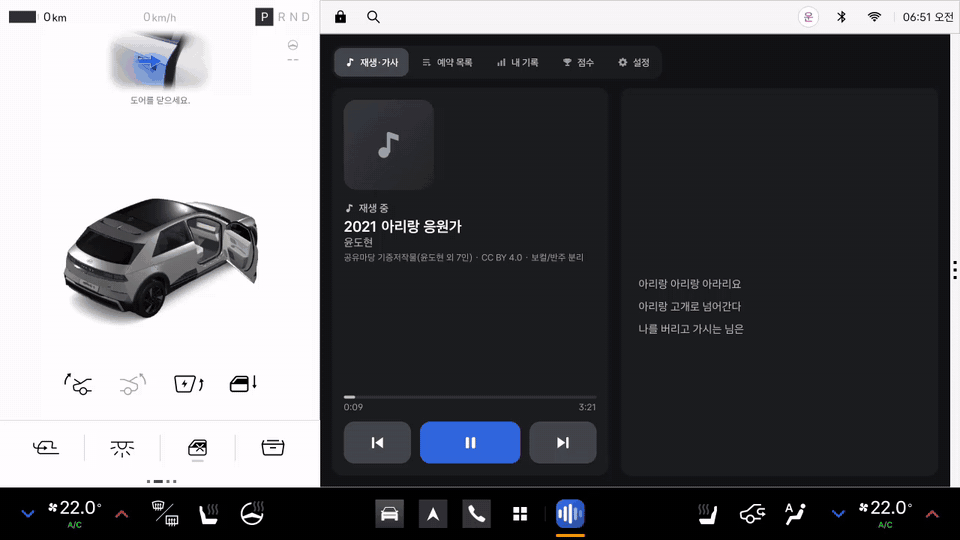

# 시치미 (Sichimi)

**차에 혼자 있고 문과 창문이 닫혔을 때만 열리는 노래방. 누가 문을 여는 순간 가수 목소리가 돌아와 시치미를 뗀다.**

혼자 출퇴근하는 운전자를 위한 Pleos Connect(Android Automotive OS) 음악 앱입니다. 켜고 끄는 버튼이 없습니다. 좌석·문·창문·기어 신호가 노래방을 여닫습니다.



*(소리 없는 화면 녹화입니다. 왼쪽 계기판에 문 열림이 보이는 순간 오른쪽 앱이 평범한 재생 화면으로 돌아갑니다. 소리는 시연 영상에서 확인해 주세요.)*

## 실행 세 단계

1. Pleos Connect Emulator 2.1.0을 켜고 가상 콘솔을 엽니다: `adb forward tcp:8088 tcp:8088` 뒤 브라우저로 `http://127.0.0.1:8088/` (탭을 열어 두어야 아래에 **DDS ONLINE**이 뜹니다).
2. 앱을 설치하고 엽니다: `adb install -r apk/Graphite_Sichimi_release.apk` → 런처의 「시치미」 (또는 `adb shell am start --user 10 -n app.sichimi/.MainActivity`).
3. 콘솔에서 **운전석만 착석**, 문·창문 모두 닫힘, **기어 D** → 앱에서 재생을 누릅니다. 5초 뒤 가수 목소리가 작아지고 「혼자만의 노래방」이 뜹니다. 콘솔에서 **동승석 문을 열면** 곧바로 가수 목소리가 돌아오고 평범한 재생 화면이 됩니다.

장면 전체(1~8)의 콘솔 조작 순서는 [docs/시연순서.md](docs/시연순서.md)에 있습니다.

## 심사 항목별로 볼 곳

| 항목 | 이 앱에서 | 증거 |
|---|---|---|
| 차량특화성 | 좌석 착석·문·창문·기어·방향지시등 신호로 "혼자이고 닫힌 차"를 판정하는 문지기(상태 기계). 휴대폰에서는 알 수 없는 차 안 상황에만 열린다 | 아래 [문지기와 신호](#문지기와-신호), 상태 기계 [`gate/`](gate/src/main/kotlin/app/sichimi/gate/PrivacyGate.kt) |
| 기술 활용성 | Pleos Vehicle SDK(Seat, Door, Window, TurnSignal), NaviHelper(남은 시간), TextToSpeech(한 줄 음성), AAOS 기어·주행 규제, Media3 미디어 세션 | 아래 [SDK 호출](#sdk-호출), [docs/검증기록.md](docs/검증기록.md)(관문 G0~G4와 장면 1~8을 가상 콘솔 신호로 확인한 기록), 상태 기계 단위 테스트 66개(`./gradlew :gate:test`), 장면 자동 검증 [`tools/verify_scenes.py`](tools/verify_scenes.py) |
| 창의성 | 노래방을 사용자가 켜지 않는다. 동승자가 타거나 문·창문이 열리면 앱이 먼저 시치미를 뗀다. 혼자가 아닐 때는 화면 어디에도 "노래방"이 없다 | 장면 2·3 스크린샷 [`docs/evidence/scenes/`](docs/evidence/scenes/) |

## 문지기와 신호

| 신호 | 출처 | 쓰는 곳 |
|---|---|---|
| 좌석 착석(운전석, 동승석, 뒷좌석 좌·우) | Vehicle SDK `Seat` | 혼자인가 |
| 문 열림(네 문) | Vehicle SDK `Door` | 닫혀 있는가 |
| 창문 위치(네 창문) | Vehicle SDK `Window` | 닫혀 있는가(기본 2% 이하) |
| 기어 | AAOS `CarPropertyManager` `GEAR_SELECTION` | 주행 화면, 후진 때 잠시 복귀, 주행 단위 기록 |
| 방향지시등 | Vehicle SDK `TurnSignal` | 잠시 복귀 |
| 남은 시간 | NaviHelper `DestinationInfo.remainTime`(초) | 마지막 곡 알림(남은 시간 3~5분, 노래방일 때 "도착까지 N분, 한 곡 더 됩니다") |

| 상태 | 가수 음량 | 들어가는 조건 |
|---|---|---|
| 일반 | 100% | 시작, 또는 혼자가 아니게 되거나 문·창문이 열림(들킬 뻔 기록) |
| 대기 | 100% | 혼자 + 닫힘 + 재생 중 + 후진·방향지시등 아님 → 5초(들킬 뻔 직후 8초) |
| 노래방 | 20%(설정 0~40%) | 대기가 끝남. 0.6초에 걸쳐 내림 |
| 잠시 복귀 | 100% | 노래방 중 후진·방향지시등. 끝나고 1.5초 뒤 다시 노래방 |

- 문이 열리면 0.12초 램프로 가수 음량을 올립니다. 신호에서 안드로이드 출력까지 약 0.25초입니다(검증기록 G2).
- 노래방일 때는 곡의 첫 소절 바로 앞 네 박에 드럼 스틱 소리(탁, 탁, 탁, 탁)로 박자를 세어 줍니다(설정 「첫 소절 박자 세기」, 기본 켬). 박자 소리는 곡 파일의 다섯 번째 채널이라 곡 박자와 표본 단위로 맞고, 혼자가 아니게 되면 가수 목소리와 함께 바로 빠집니다(검증기록 "박자 세기").
- 스스로 재생을 시작하지 않습니다. 사용자가 재생한 곡의 가수 음량만 바꿉니다.
- 주행 중(기어 P가 아니거나 주행 규제)에는 상태·곡·버튼 셋만 있는 화면입니다. 가사와 목록은 주차 중에만 보입니다.

## SDK 호출

| SDK | 호출 | 파일 |
|---|---|---|
| Vehicle 2.3.2 | `getSeat().checkSeatOccupancyCapabilities / getCurrentSeatOccupancy / registerSeatOccupancy`, `getDoor().…DoorPosition…`, `getWindow().…WindowPosition…`, `getTurnSignal().getCurrentTurnSignalState / registerTurnSignalState` | [`vehicle/VehicleSignals.kt`](app/src/main/java/app/sichimi/vehicle/VehicleSignals.kt) |
| AAOS Car API | `CarPropertyManager` `GEAR_SELECTION`, `CarUxRestrictionsManager` | [`vehicle/VehicleSignals.kt`](app/src/main/java/app/sichimi/vehicle/VehicleSignals.kt), [`core/DrivingRestrictions.kt`](app/src/main/java/app/sichimi/core/DrivingRestrictions.kt) |
| NaviHelper 3.0.5 | `initialize`, `addListener`, `getDestinationInfo`, `onDestinationInfo`, `onDrivingInfo`, `onRouteCancelled` | [`navi/NaviRemaining.kt`](app/src/main/java/app/sichimi/navi/NaviRemaining.kt) |
| TextToSpeech 3.3.1 | `TextToSpeech(context, Mode.ON_DEVICE)`, `initialize`, `setLocale`, `speak` | [`audio/Announcer.kt`](app/src/main/java/app/sichimi/audio/Announcer.kt) |
| Media3 1.4.1 | `MediaLibraryService`, `MediaLibrarySession`(검색·미디어 ID 재생), ExoPlayer + 스템 믹서 `AudioProcessor` | [`audio/PlaybackService.kt`](app/src/main/java/app/sichimi/audio/PlaybackService.kt), [`audio/StemMixProcessor.kt`](app/src/main/java/app/sichimi/audio/StemMixProcessor.kt) |

권한: `pleos.car.permission.CAR_SEATS`, `CAR_DOORS`, `CAR_WINDOWS`, `CAR_LIGHTS`, `NAVI_ROUTE`, `TTS_SERVICE`, `android.car.permission.CAR_POWERTRAIN`. 제어(쓰기) API는 쓰지 않습니다.

## 테스트 환경과 필요한 설정

- Pleos Connect Emulator 2.1.0 (AAOS API 34, x86_64), 가상 콘솔 연결(DDS ONLINE). 화면 사용자는 10번입니다.
- 이 에뮬레이터는 **좌석 착석 값이 반대로** 옵니다. 앱 설정의 "착석 값 뒤집기"가 기본으로 켜져 있습니다(실차에서 반대로 동작하면 끕니다). 검증기록 G1.
- 장면 7(마지막 곡)은 노래방 상태에서 에뮬레이터 내비에 남은 시간 3~4분 목적지(예: 검색 → 음식점 → 「탐앤탐스 세종연구소입구점」)를 넣으면 들립니다. 앱이 재생 중이어야 내비 이벤트를 받습니다. TTS는 ON_DEVICE 모드라 Playground 앱 등록이나 키가 필요 없습니다.
- 빌드: JDK 17, Gradle 8.10.2(래퍼), AGP 8.7.3, Kotlin 2.0.21, compileSdk 34, minSdk 28.

## APK

`apk/Graphite_Sichimi_release.apk` (release 빌드, 62MB). 이 APK로 장면 1~6, 8과 박자 세기를 에뮬레이터에서 확인했습니다. 장면 7은 바로 앞 release APK로 확인했고, 이번에는 에뮬레이터 내비가 열리지 않아 다시 돌리지 못했습니다([검증기록](docs/검증기록.md)의 release 절과 박자 세기 절).

직접 빌드하려면:

```bash
./gradlew :gate:test            # 문지기·기록 단위 테스트
./gradlew :app:assembleDebug    # app/build/outputs/apk/debug/app-debug.apk
```

release 서명은 저장소 밖의 키를 `keystore.properties`(저장소에 넣지 않음)로 읽습니다. 없으면 release 빌드는 서명 없이 만들어집니다.

## 음원

곡 목록과 출처·라이선스는 [NOTICE.md](NOTICE.md)에 있습니다. 곡마다 반주(좌·우), 보컬(좌·우), 박자 세기 소리를 5채널 Opus 한 파일(`mix5.ogg`)에 담아 서로 어긋나지 않게 합니다(`tools/pack_stems.py`, 박자 소리는 `tools/count_in.py`).

## 구조

```
gate/   순수 Kotlin. 문지기 상태 기계(PrivacyGate), 혼자 부른 시간 장부(SoloLedger), 마지막 곡 규칙(LastSongCue), 박자 세기 규칙(CountIn)과 단위 테스트
app/    Android 앱. 차 신호, 문지기 연결, 스템 믹서, Media3 재생 서비스, Room 기록, Compose 화면, 내비·TTS
tools/  가상 콘솔 조작(console.py), 관문·장면 검증 스크립트, 스템 묶기, 가사 초안·시각 맞춤, 박자 세기 트랙
docs/   검증기록과 증거(스크린샷, 로그)
```

- 기록은 기기 안 Room DB에만 둡니다. 네트워크로 보내는 것이 없고 마이크를 쓰지 않습니다.
- 개발 과정에서 생성형 AI(Claude)를 썼습니다.
