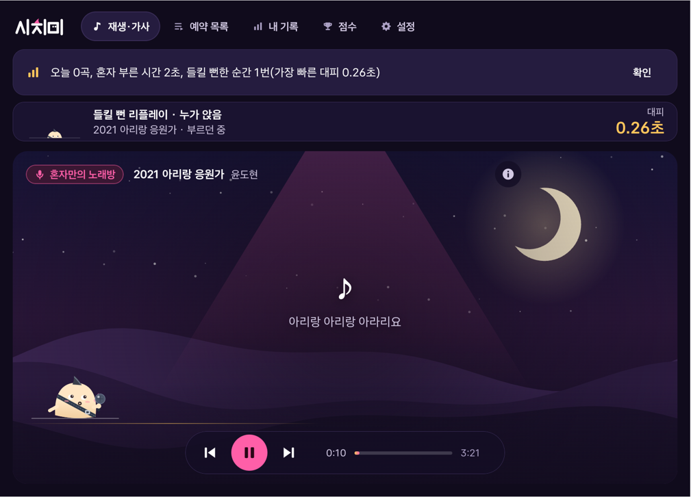
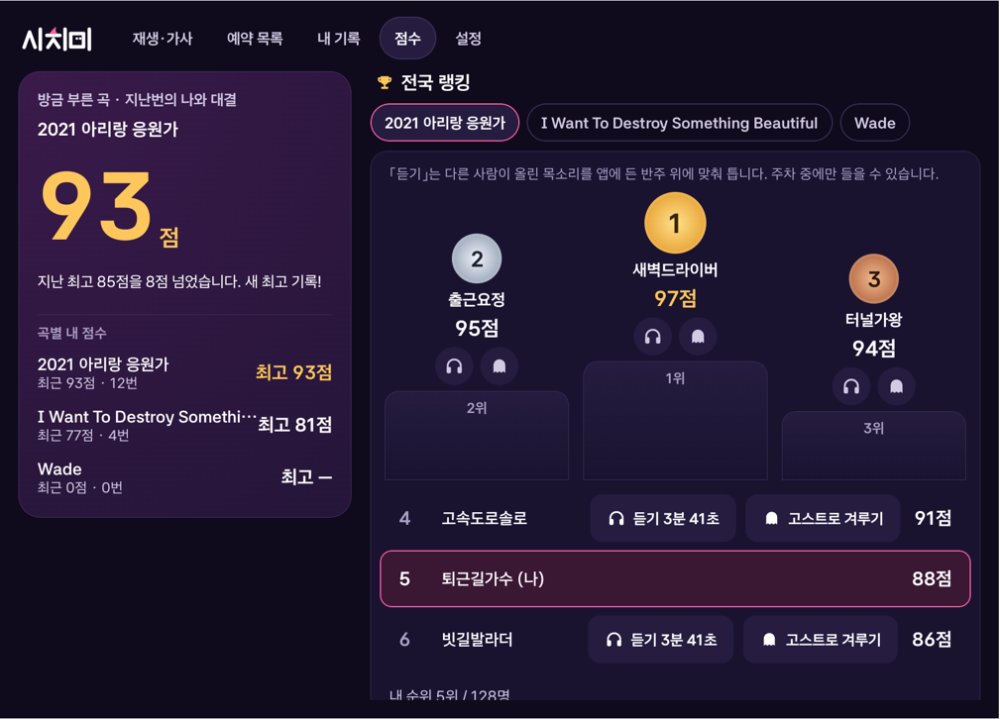
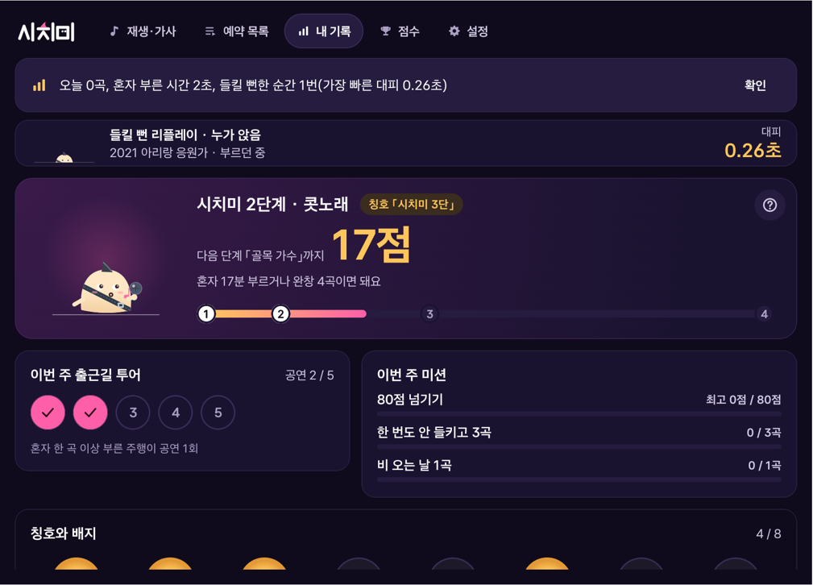
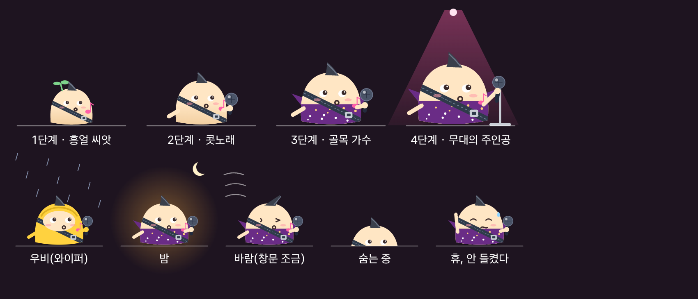

# 시치미 (Sichimi)

**차에 혼자 있고 문과 창문이 닫혔을 때만 열리는 노래방. 누가 문을 여는 순간 가수 목소리가 돌아와 시치미를 뗀다.**

혼자 출퇴근하는 운전자를 위한 Pleos Connect(Android Automotive OS) 음악 앱입니다. 켜고 끄는 버튼이 없습니다. 좌석·문·창문·기어 신호가 노래방을 여닫습니다.


*(소리 없는 화면 녹화, 주차 중. 동승석 문이 열려 있는 동안은 평범한 재생 화면 → 문이 닫히고 5초 뒤 「혼자만의 노래방」 무대(가사가 왼쪽부터 채워지고 시치미가 노래함) → 왼쪽 계기판에 문 열림이 보이는 순간 오른쪽 앱이 평범한 재생 화면으로 돌아갑니다. 소리는 시연 영상에서 확인해 주세요.)*

## 실행 세 단계

1. Pleos Connect Emulator 2.1.0을 켜고 가상 콘솔을 엽니다: `adb forward tcp:8088 tcp:8088` 뒤 브라우저로 `http://127.0.0.1:8088/` (탭을 열어 두어야 아래에 **DDS ONLINE**이 뜹니다).
2. 앱을 설치하고 엽니다: `adb install -r apk/Graphite_Sichimi_release.apk` → 런처의 「시치미」 (또는 `adb shell am start --user 10 -n app.sichimi/.MainActivity`).
3. 콘솔에서 **운전석만 착석**, 문·창문 모두 닫힘, **기어 D** → 앱에서 재생을 누릅니다. 5초 뒤 가수 목소리가 작아지고 「혼자만의 노래방」이 뜹니다. 콘솔에서 **동승석 문을 열면** 곧바로 가수 목소리가 돌아오고 평범한 재생 화면이 됩니다.

장면 전체(1~8)의 콘솔 조작 순서는 [docs/시연순서.md](docs/시연순서.md)에 있습니다.

## 노래 점수와 전국 랭킹

혼자만의 노래방에서는 노래방 기계처럼 100점 만점 점수를 매길 수 있습니다(설정 「노래 점수(마이크)」, 기본 끔, 켤 때 마이크 권한을 묻습니다).

- 마이크는 **혼자만의 노래방이고 재생 중일 때만** 켭니다. 동승자가 타거나 문이 열리면 바로 끕니다. 점수에는 20ms마다 음높이 숫자만 씁니다. 「전국 랭킹에 올리기」를 켜지 않으면 소리는 저장하지 않습니다.
- 원곡 보컬 스템에서 미리 뽑은 음높이 흐름(`songs/<id>/pitch.u8`)과 같은 순간의 내 음높이를 비교합니다. 옥타브는 따지지 않고(남녀 키 차이), 박자는 앞뒤 0.2초까지 봐 줍니다.
- 운전 중 화면에는 점수를 띄우지 않습니다. 곡이 끝나면 음성으로 한 줄("○○, 92점. 최고 기록이에요")만 말합니다.
- 주차하면 「점수」 탭에서 **지난번의 나와 대결**(이번 점수와 지난 최고 기록), 곡별 내 최고 점수, **전국 랭킹**(곡별 위 10명과 내 순위)을 봅니다. 혼자가 아니면 이 탭은 보이지 않습니다.
- 전국 랭킹은 설정 「전국 랭킹에 올리기」를 켰을 때만 별명과 곡별 최고 점수를 보냅니다(Firebase Firestore, 익명 로그인). 차 신호, 주행 기록은 보내지 않습니다.
- **녹음 공개**: 「전국 랭킹에 올리기」를 켤 때 "녹음도 함께 공개됩니다"를 먼저 보여 주고 한 번 더 누르게 합니다. 켜 두면 혼자만의 노래방에서 부른 **내 목소리만**(반주·원곡은 녹음하지 않음) 곡 시각에 맞춰 모아, 그 곡의 최고 기록이 되면 AAC(16kHz 모노, 최대 32kbps)로 압축해 차 안에 둡니다. 「점수」 탭에서 **미리 듣고** 「녹음 올리기」를 눌러야 서버에 올라갑니다. 점수 올리기와는 따로라, 녹음이 실패해도 점수는 올라갑니다.
- 다른 사람의 녹음은 랭킹 줄의 「듣기」로, 앱에 든 반주 위에 목소리를 맞춰 노래방처럼 틉니다. **기어 P이고 혼자일 때만** 틀 수 있고, 기어를 바꾸거나 동승자가 타면 바로 멈춥니다. 스스로 다시 틀지 않습니다.
- 녹음은 Firestore 문서 하나(`rank/{곡}/takes/{uid}`, 900,000바이트 이하)에 넣습니다. 앱의 세 곡은 모두 4분 미만이라 곡 전체가 들어가고, 더 긴 곡은 앞 7분까지만 담습니다. 점수 문서와 따로 두어 랭킹 목록을 읽을 때 소리까지 받지 않습니다.
- 확인: 가상 마이크에 원곡 보컬을 넣으면 93점, 다른 곡 보컬은 21점, 끝까지 85점과 음성 안내(검증기록 G5).

## 혼자 달리는 출퇴근길이 나만의 무대가 된다 (v2)

혼자이고 주차 중이면 재생 탭이 노래방 무대가 됩니다. 동승자가 있거나 일반 상태일 때는 아래 어느 것도 보이지 않습니다(1차 화면과 이미지 비교에서 다른 화소 0개, [검증기록](docs/검증기록.md) v3 절).

| 무대 | 점수(전국 랭킹 단상) | 내 기록 |
|---|---|---|
|  |  |  |

*(점수 화면은 서버 기록이 적어 debug 전용 미리보기에 예시 별명·점수를 넣어 찍었습니다. 무대와 내 기록은 실제 앱입니다.)*



- **무대**: 곡마다 자체 제작 아트 위에 지금 가사 줄이 노래방처럼 왼쪽부터 채워집니다. 곡이 끝나면 노래방 기계식 점수 화면(주행 중에 끝났으면 다음 주차 때).
- **시치미**: 늘 딴청(흘끗 보며 휘파람) 부리는 자체 캐릭터. 머리에 차 지붕 상어지느러미 안테나, 몸에 안전벨트. 혼자 부른 시간·완창·잘 숨은 기록·미션으로 4단계까지 자랍니다(들킨 횟수로는 깎이지 않음). 노래방 중에 문이 열리면 가수 목소리가 돌아오는 순간 0.3초 만에 계기판 선 아래로 숨어 안테나와 두 눈만 남기고, 다시 혼자가 되면 "휴, 안 들켰다". 와이퍼(Vehicle SDK Wiper)를 켜면 우비, 밤이면 달과 조명, 창문이 조금 열리면 바람.
- **가장 빠른 대피 랭킹**: 들킬 뻔한 순간 가수 목소리가 돌아오기까지의 시간을 곡별·주간 전국 랭킹으로(별명만 공개, 「전국 랭킹에 올리기」를 켰을 때만). 오늘 요약에 들킬 뻔 리플레이 카드.
- **고스트 대결**: 랭킹에서 다른 사람 녹음을 고르면, 다음에 그 곡을 혼자 부를 때 그 목소리가 아주 작게 깔립니다(가이드보다 작게, 가수 음량과 같은 램프라 동승자가 타면 함께 사라짐). 끝나면 점수 비교.
- **출근길 투어와 이번 주 미션**: 혼자 한 곡 이상 부른 주행 = 공연 1회, 주 5회면 투어 완주 포스터. 이번 주 미션 3개, 칭호·배지 8개.
- 주행 중 화면은 혼자 노래방일 때 무대 색과 그 곡의 정지된 아트만 바뀝니다(가사·점수·캐릭터·움직임·로고 없음). 주행 중의 재미는 소리로만(곡 끝 음성 한 줄, 고스트 목소리).
- **디자인 체계 「한밤 무대」(v3)**: 혼자일 때 보이는 화면 전체를 하나의 체계로 묶었습니다. 무대 바탕 #100B1C, 대표 강조 시치미 분홍 #FF5FA8, 보조 강조 달빛 금색 #FFC65C, 카드 무게 세 단계(대표·기본·조용한), 직접 그린 「시치미」 글자 로고(ㅊ 꼭지는 상어지느러미 안테나, ㅁ 안은 딴청 눈), 같은 언어로 다시 그린 앱 아이콘(계기판 선 위로 안테나와 눈만 빼꼼). 두 방향 시안을 비교해 골랐습니다: [`docs/design/`](docs/design/디자인체계.md).

## 심사 항목별로 볼 곳

| 항목 | 이 앱에서 | 증거 |
|---|---|---|
| 차량특화성 | 좌석 착석·문·창문·기어·방향지시등 신호로 "혼자이고 닫힌 차"를 판정하는 문지기(상태 기계). 휴대폰에서는 알 수 없는 차 안 상황에만 열린다 | 아래 [문지기와 신호](#문지기와-신호), 상태 기계 [`gate/`](gate/src/main/kotlin/app/sichimi/gate/PrivacyGate.kt) |
| 기술 활용성 | Pleos Vehicle SDK(Seat, Door, Window, TurnSignal), NaviHelper(남은 시간), TextToSpeech(한 줄 음성), AAOS 기어·주행 규제, Media3 미디어 세션, 마이크 음높이 채점(YIN) | 아래 [SDK 호출](#sdk-호출), [docs/검증기록.md](docs/검증기록.md)(관문 G0~G5와 장면 1~8을 가상 콘솔 신호로 확인한 기록), 문지기·채점·녹음·무대 단위 테스트 119개(`./gradlew :gate:test`), 장면 자동 검증 [`tools/verify_scenes.py`](tools/verify_scenes.py) |
| 창의성 | 노래방을 사용자가 켜지 않는다. 동승자가 타거나 문·창문이 열리면 앱이 먼저 시치미를 뗀다. 혼자가 아닐 때는 화면 어디에도 "노래방"이 없다 | 장면 2·3 스크린샷 [`docs/evidence/scenes/`](docs/evidence/scenes/) |
| 재미(v2) | 혼자·밀폐 신호와 들킬 뻔한 순간이 그대로 놀이가 된다: 시치미가 숨고, 대피 시간이 랭킹이 되고, 녹음이 고스트가 된다 | v2 흐름 증거 [`docs/evidence/v2/`](docs/evidence/v2/), 대표 화면 [`docs/evidence/ui/after_v2/`](docs/evidence/ui/after_v2/), 순수 로직 단위 테스트 119개 |
| 화면(Pleos UI 가이드 + 한밤 무대) | 두 체계를 나눠 씀: 동승자가 있거나 일반 상태일 때는 Pleos 다크 토큰 그대로의 평범한 플레이어, 혼자일 때는 「한밤 무대」 체계(로고, 분홍·금색, 메달·단상, 하나로 이어진 조작부). 글자 크기는 Pleos 체계(본문 24sp 이상), 주행 화면 버튼 136dp, 대비 4.5:1 이상(69쌍), 움직임은 기어 P에서만 | 디자인 체계와 시안 [`docs/design/`](docs/design/디자인체계.md), 코드 [`ui/Night.kt`](app/src/main/java/app/sichimi/ui/Night.kt)·[`ui/Theme.kt`](app/src/main/java/app/sichimi/ui/Theme.kt), 대비 검사 [`tools/check_contrast.py`](tools/check_contrast.py), v2→v3 비교 [`docs/evidence/ui/after_v3/compare_v2/`](docs/evidence/ui/after_v3/compare_v2/) |

## 문지기와 신호

| 신호 | 출처 | 쓰는 곳 |
|---|---|---|
| 좌석 착석(운전석, 동승석, 뒷좌석 좌·우) | Vehicle SDK `Seat` | 혼자인가 |
| 문 열림(네 문) | Vehicle SDK `Door` | 닫혀 있는가 |
| 창문 위치(네 창문) | Vehicle SDK `Window` | 닫혀 있는가(기본 2% 이하) |
| 기어 | AAOS `CarPropertyManager` `GEAR_SELECTION` | 주행 화면, 후진 때 잠시 복귀, 주행 단위 기록 |
| 방향지시등 | Vehicle SDK `TurnSignal` | 잠시 복귀 |
| 남은 시간 | NaviHelper `DestinationInfo.remainTime`(초) | 마지막 곡 알림(남은 시간 3~5분, 노래방일 때 "도착까지 N분, 한 곡 더 됩니다") |

| 상태 | 가수 음량 | 들어가는 조건 |
|---|---|---|
| 일반 | 100% | 시작, 또는 혼자가 아니게 되거나 문·창문이 열림(들킬 뻔 기록) |
| 대기 | 100% | 혼자 + 닫힘 + 재생 중 + 후진·방향지시등 아님 → 5초(들킬 뻔 직후 8초) |
| 노래방 | 20%(설정 0~40%) | 대기가 끝남. 0.6초에 걸쳐 내림 |
| 잠시 복귀 | 100% | 노래방 중 후진·방향지시등. 끝나고 1.5초 뒤 다시 노래방 |

- 문이 열리면 0.12초 램프로 가수 음량을 올립니다. 신호에서 안드로이드 출력까지 약 0.25초입니다(검증기록 G2).
- 노래방일 때는 곡의 첫 소절 바로 앞 네 박에 드럼 스틱 소리(탁, 탁, 탁, 탁)로 박자를 세어 줍니다(설정 「첫 소절 박자 세기」, 기본 켬). 박자 소리는 곡 파일의 다섯 번째 채널이라 곡 박자와 표본 단위로 맞고, 혼자가 아니게 되면 가수 목소리와 함께 바로 빠집니다(검증기록 "박자 세기").
- 스스로 재생을 시작하지 않습니다. 사용자가 재생한 곡의 가수 음량만 바꿉니다.
- 주행 중(기어 P가 아니거나 주행 규제)에는 상태·곡·버튼 셋만 있는 화면입니다. 가사와 목록은 주차 중에만 보입니다.
- 화면은 Pleos UI 디자인 가이드의 다크 테마 값(배경 #131417·#1D1E21, 표면 #313236, 버튼 #44464E, 미디어 강조색)과 크기 체계(Headline 56, Title 40·36·32, Body 30·28·26, Label 24)를 따릅니다. 아이콘은 직접 그린 한 벌(24 격자)이고, 눌렀을 때는 색만 바뀝니다. 혼자일 때 보이는 화면(노래방 무대, 내 기록·점수·설정 탭, 덮개 카드)은 「한밤 무대」 체계(분홍·금색, 로고)를 쓰고, 동승자가 볼 수 있는 화면에는 이 체계의 어떤 것(로고 포함)도 나오지 않습니다.

## SDK 호출

| SDK | 호출 | 파일 |
|---|---|---|
| Vehicle 2.3.2 | `getSeat().checkSeatOccupancyCapabilities / getCurrentSeatOccupancy / registerSeatOccupancy`, `getDoor().…DoorPosition…`, `getWindow().…WindowPosition…`, `getTurnSignal().getCurrentTurnSignalState / registerTurnSignalState` | [`vehicle/VehicleSignals.kt`](app/src/main/java/app/sichimi/vehicle/VehicleSignals.kt) |
| AAOS Car API | `CarPropertyManager` `GEAR_SELECTION`, `CarUxRestrictionsManager` | [`vehicle/VehicleSignals.kt`](app/src/main/java/app/sichimi/vehicle/VehicleSignals.kt), [`core/DrivingRestrictions.kt`](app/src/main/java/app/sichimi/core/DrivingRestrictions.kt) |
| NaviHelper 3.0.5 | `initialize`, `addListener`, `getDestinationInfo`, `onDestinationInfo`, `onDrivingInfo`, `onRouteCancelled` | [`navi/NaviRemaining.kt`](app/src/main/java/app/sichimi/navi/NaviRemaining.kt) |
| TextToSpeech 3.3.1 | `TextToSpeech(context, Mode.ON_DEVICE)`, `initialize`, `setLocale`, `speak` | [`audio/Announcer.kt`](app/src/main/java/app/sichimi/audio/Announcer.kt) |
| Media3 1.4.1 | `MediaLibraryService`, `MediaLibrarySession`(검색·미디어 ID 재생), ExoPlayer + 스템 믹서 `AudioProcessor` | [`audio/PlaybackService.kt`](app/src/main/java/app/sichimi/audio/PlaybackService.kt), [`audio/StemMixProcessor.kt`](app/src/main/java/app/sichimi/audio/StemMixProcessor.kt) |
| Android 마이크 | `AudioRecord`(16kHz 모노, `VOICE_RECOGNITION`), YIN 음높이 | [`audio/MicPitch.kt`](app/src/main/java/app/sichimi/audio/MicPitch.kt), [`core/SingCoach.kt`](app/src/main/java/app/sichimi/core/SingCoach.kt), [`gate/SingScore.kt`](gate/src/main/kotlin/app/sichimi/gate/SingScore.kt) |
| Firebase(REST) | Identity Toolkit `accounts:signUp`(익명), Firestore `documents`·`runQuery`(녹음 목록은 `select`로 소리를 빼고 읽음). Pleos 차에는 Google Play 서비스가 없어 SDK 대신 REST | [`rank/RankingClient.kt`](app/src/main/java/app/sichimi/rank/RankingClient.kt), 보안 규칙 [`docs/firestore.rules`](docs/firestore.rules) |

권한: `pleos.car.permission.CAR_SEATS`, `CAR_DOORS`, `CAR_WINDOWS`, `CAR_LIGHTS`, `NAVI_ROUTE`, `TTS_SERVICE`, `android.car.permission.CAR_POWERTRAIN`, `android.permission.RECORD_AUDIO`(노래 점수를 켤 때 묻는다), `INTERNET`(전국 랭킹). 차 제어(쓰기) API는 쓰지 않습니다.

## 테스트 환경과 필요한 설정

- Pleos Connect Emulator 2.1.0 (AAOS API 34, x86_64), 가상 콘솔 연결(DDS ONLINE). 화면 사용자는 10번입니다.
- 이 에뮬레이터는 **좌석 착석 값이 반대로** 옵니다. 앱 설정의 "착석 값 뒤집기"가 기본으로 켜져 있습니다(실차에서 반대로 동작하면 끕니다). 검증기록 G1.
- 장면 7(마지막 곡)은 노래방 상태에서 에뮬레이터 내비에 남은 시간 3~5분 목적지(예: 검색 → 음식점 → 「탐앤탐스 세종연구소입구점」)를 넣으면 들립니다. 앱이 재생 중이어야 내비 이벤트를 받습니다. TTS는 ON_DEVICE 모드라 Playground 앱 등록이나 키가 필요 없습니다.
- 노래 점수는 에뮬레이터의 마이크 입력을 씁니다(확장 컨트롤 → 마이크 → "Virtual microphone uses host audio input", 또는 `adb emu avd hostmicon`). 저장소의 APK에는 전국 랭킹 서버가 연결돼 있습니다. 직접 빌드할 때는 `app/google-services.json`(Firebase 프로젝트, 저장소에 넣지 않음)이 있어야 랭킹이 켜지고, 없으면 랭킹 칸만 "연결 안 됨"이고 나머지는 그대로입니다.
- 빌드: JDK 17, Gradle 8.10.2(래퍼), AGP 8.7.3, Kotlin 2.0.21, compileSdk 34, minSdk 28.

## APK

`apk/Graphite_Sichimi_release.apk` (release 빌드, 63MB). 앞선 빌드들로 장면 1~8, 박자 세기, 노래 점수(가상 마이크), 전국 랭킹 서버 연결을 에뮬레이터에서 확인했고, 이 빌드(v3 한밤 무대 디자인)로 장면 1~5, 8, 랭킹 녹음(녹음·미리 듣기·주행/동승자 때 멈춤·서버에 올리고 받아 듣고 지우기), 대피 기록 올리기·대피 랭킹 화면, 동승자 화면 이미지 비교를 다시 확인했습니다([검증기록](docs/검증기록.md)의 마지막 절).

직접 빌드하려면:

```bash
./gradlew :gate:test            # 문지기·기록 단위 테스트
./gradlew :app:assembleDebug    # app/build/outputs/apk/debug/app-debug.apk
```

release 서명은 저장소 밖의 키를 `keystore.properties`(저장소에 넣지 않음)로 읽습니다. 없으면 release 빌드는 서명 없이 만들어집니다.

## 음원

곡 목록과 출처·라이선스는 [NOTICE.md](NOTICE.md)에 있습니다. 곡마다 반주(좌·우), 보컬(좌·우), 박자 세기 소리를 5채널 Opus 한 파일(`mix5.ogg`)에 담아 서로 어긋나지 않게 합니다(`tools/pack_stems.py`, 박자 소리는 `tools/count_in.py`).

## 구조

```
gate/   순수 Kotlin. 문지기 상태 기계(PrivacyGate), 혼자 부른 시간 장부(SoloLedger), 마지막 곡 규칙(LastSongCue), 박자 세기 규칙(CountIn), 노래 점수(SingScore, YIN)와 단위 테스트
app/    Android 앱. 차 신호, 문지기 연결, 스템 믹서, Media3 재생 서비스, Room 기록, Compose 화면, 내비·TTS, 마이크 채점, 전국 랭킹(REST)
tools/  가상 콘솔 조작(console.py), 관문·장면 검증 스크립트, 스템 묶기, 가사 초안·시각 맞춤, 박자 세기 트랙, 채점 기준 음높이
docs/   검증기록과 증거(스크린샷, 로그)
```

- 기록은 기기 안 Room DB에만 둡니다. 밖으로 보내는 것은 사용자가 「전국 랭킹에 올리기」를 켰을 때의 별명과 곡별 최고 점수, 그리고 사용자가 「녹음 올리기」를 누른 녹음뿐입니다. 마이크는 노래 점수를 켰을 때 혼자만의 노래방에서만 씁니다.
- **녹음은 서버(Firebase Firestore)에 공개로 저장되어 누구나 들을 수 있습니다.** 지우는 법: 「점수」 탭의 내 녹음 「지우기」(서버와 차 안 모두), 또는 설정의 「서버의 내 녹음 모두 지우기」. 보안 규칙이 본인 녹음만 지울 수 있게 합니다. 올리기 전 녹음은 앱 전용 폴더에만 있고, 설정의 「기록 지우기」로도 지워집니다.
- 개발 과정에서 생성형 AI(Claude)를 썼습니다.
